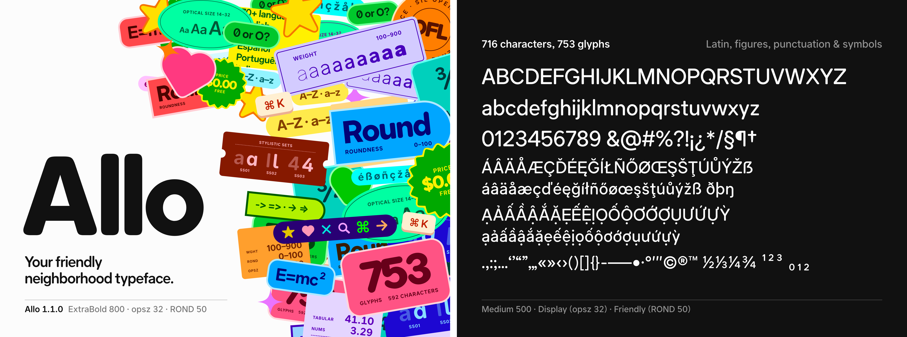
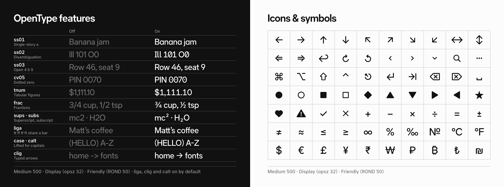

# Allo

Allo is your friendly neighborhood typeface. It’s variable in weight and roundness, with proportions and curves
designed to feel warm without being too cute and clear without being too cold. It’s a perfect companion out of the
box, and three variable axes and plenty of alternates let you tune its personality to exactly what you need.

Allo is optimized for screens and interfaces, with an optical size that adjusts automatically between text and
display. And it’s packed with big little details: tabular figures, fractions, punctuation that lifts beside capitals,
arrows that appear when you type them, a host of alternates and symbols, as well as a true oblique in every weight.

### [Type specimen at allo.joshpuckett.me →](https://allo.joshpuckett.me)

<br>




## Download

Get `Allo-1.0.3.zip` from the [latest release](https://github.com/joshpuckett/allo/releases/latest):

| Folder | Contents |
|---|---|
| `fonts/otf` | 18 static fonts for **Allo** and 18 for **Allo Mono**, Thin to Black, each with an Oblique |
| `fonts/variable` | `AlloVariable.ttf` and `AlloMonoVariable.ttf`: all optical sizes, weights and roundnesses |
| `fonts/webfonts` | The same fonts as WOFF2, plus `AlloVariableFriendly.woff2` and `AlloMonoVariableFriendly.woff2` (roundness fixed at 50, about half the size) |

The static and variable fonts are separate families (**Allo** / **Allo Variable**, and **Allo Mono** / **Allo Mono Variable**), so both can be installed.

## Allo Mono

**Allo Mono** is the monospace sibling built for coding, terminals, and TUIs:

- **Fixed cell width:** `1060` units on a `2048` UPM (`0.518 em`) across all glyphs, weights, optical sizes, roundness values, and obliques (`isFixedPitch=1`, PANOSE monospaced, zero kerning).
- **Coding disambiguation on by default:** serifed `I`, `i`, `l`, `j`, footed `1`, and slashed `0` (with `cv05` dotted zero, `cv06` plain zero, `cv07` serifless `I`, `ss01` single-story `a`, `ss03` open figures).
- **Grid-safe coding ligatures (`calt`):** `->`, `<-`, `-->`, `<--`, `<->`, `=>`, `<=>`, `!=`, `!==`, `==`, `===`, `<=`, `>=` implemented as 1-to-1 cell-preserving substitutions so columns and cursors never shift. Disable with `font-variant-ligatures: no-contextual`.
- **Terminal & TUI coverage:** full Unicode Box Drawing (`U+2500`–`U+257F`), Block Elements (`U+2580`–`U+259F`), and Powerline symbols (`U+E0A0`–`U+E0A2`, `U+E0B0`–`U+E0B3`), with legacy PUA codes cleared so icon fallbacks don't collide.
- **Axes (`Allo Mono Variable`):** `opsz` `14–32` (Text to Display), `wght` `100–900`, `ROND` `0–100` (Sharp to Round).

```js
import "allo-font/mono";            // Allo Mono variable font + obliques
// import "allo-font/mono-friendly"; // roundness fixed at 50, smaller file
```

```css
code, pre {
  font-family: "Allo Mono", ui-monospace, monospace;
}
```

## Web

From npm:

```sh
npm install allo-font
```

```js
import "allo-font";            // the full variable font, and the obliques
// import "allo-font/friendly"; // or: roundness fixed at 50, about half the size
```

```css
body {
  font-family: "Allo", system-ui, sans-serif;
}
```

Or host the files yourself, from `fonts/webfonts`:

```css
@font-face {
  font-family: "Allo";
  src: url("AlloVariable.woff2") format("woff2");
  font-weight: 100 900;
  font-style: normal;
  font-display: swap;
}

body {
  font-family: "Allo", system-ui, sans-serif;
}
```

- **Optical size** follows the font size (`font-optical-sizing: auto`, the CSS default). Set it to `none` to keep the
  Text design at every size, or pick one with `font-variation-settings: "opsz" 32`.
- **Roundness** has no CSS property: use `font-variation-settings: "ROND" 0` (sharp) to `"ROND" 100` (round).
  Default 50.
- **Smaller file:** `AlloVariableFriendly.woff2` has roundness fixed at 50; `"ROND"` has no effect. Its family name
  is "Allo Variable Friendly".
- **Obliques:** the npm CSS includes them. Self-hosting, add an `@font-face` with `font-style: italic` and the matching `font-weight` for each oblique WOFF2
  you use (`Allo-Oblique.woff2`, `Allo-BoldOblique.woff2`, …).

## Axes

| Axis | Tag | Range | Default | Named values |
|---|---|---|---|---|
| Optical size | `opsz` | 9–32 | 14 | 9 Small, 14 Text, 32 Display |
| Weight | `wght` | 100–900 | 400 | Thin 100 to Black 900 |
| Roundness | `ROND` | 0–100 | 50 | 0 Sharp, 50 Friendly, 100 Round |

Display (32) is tighter, with stronger optical corrections. Below 14 only the spacing changes. The static fonts are
the variable font at opsz 14, ROND 50.

## OpenType features

| Feature | Effect |
|---|---|
| `ss01` Single-story a | ɑ-shaped a |
| `ss02` Disambiguation | Serifed I, tailed l, footed 1, slashed zero |
| `ss03` Open figures | Open 4, 6 and 9 |
| `cv01`–`cv04` | Footed 1, slashed zero, tailed l, serifed I, separately |
| `cv05` | Dotted zero |
| `tnum` | Tabular figures |
| `zero` | Slashed zero |
| `frac` | Fractions: 1/2 → ½ |
| `sups`, `subs`, `numr`, `dnom` | Superscript, subscript, numerator, denominator |
| `case` | Punctuation and symbols raised for capitals |
| `liga` | tt, ff, tf, ft with a shared crossbar |
| `calt` | `->` → →; brackets, signs, ¿ and ¡ raised beside capitals and figures |

Browsers turn ligatures off when letter-spacing is set. For code, use `font-variant-ligatures: no-contextual`.

## Build

Python 3.9 or newer:

```sh
python3 -m venv .venv
.venv/bin/python -m pip install -r requirements.txt
.venv/bin/python build.py
```

Writes `fonts/` (variable TTFs and WOFF2s; 18 static OTFs and WOFF2s each for Allo and Allo Mono, autohinted with AFDKO), `fonts/SHA256SUMS`, `Allo-1.0.3.zip`, and `AlloMono-1.0.3.zip`. Dependencies are pinned and `release.json` fixes the timestamp, so builds are reproducible.

To regenerate the Allo Mono UFO sources from the proportional masters and static UFOs:

```sh
.venv/bin/python scripts/generate_mono.py
```

## Sources

`sources/Allo.designspace` (designspace 5, UFO) has 48 masters: opsz 9, 14, 20, 32 × wght 100, 400, 580, 900 ×
ROND 0, 50, 100, plus eight sparse layers at ROND 10 and 30 for heavy joins. The opsz 9 masters are the opsz 14
masters with wider spacing (`release.json` "smallShift"). Corners are rounded in the outlines; the build compiles
the sources as they are. Keep points compatible across masters.

`sources/static` holds the 18 static fonts' sources: cut from the variable masters at opsz 14, ROND 50, then edited
separately. The obliques are separate drawings, not a slant axis.

`sources/AlloMono.designspace`, `sources/mono-masters`, and `sources/mono-static` hold the monospace sources
(opsz 14, 20, 32 × wght 100, 400, 580, 900 × ROND 0, 50, 100 + 8 sparse layers, plus 18 static UFOs).

## Contributing

Found a problem, or missing a character? Please [open an issue](https://github.com/joshpuckett/allo/issues); a
screenshot and the text you typed help a lot.

Pull requests that change the masters or the font files aren't accepted for now. Every change to a letter gets
reviewed by eye across all the weights and axes, and that's hard to do well for work that arrives from outside. If
you have a larger idea, such as a new script, open an issue first so we can talk about it.

You're free to modify Allo and ship your own version under the [license](OFL.txt).

## License

[SIL Open Font License 1.1](OFL.txt): free to use, modify and redistribute, including commercially. The fonts can't
be sold by themselves.

## Credit

Allo began from [Inter](https://github.com/rsms/inter) 4.2, which provided an incredible base to work from. Every
one of Allo's glyphs has been redrawn, with extensive work on spacing, kerning, features and axes, all tuned for the
friendly character that makes Allo its own. I owe a huge debt of gratitude to my friend [Rasmus Andersson](https://rsms.me) for creating
Inter and releasing it under an open license; without it, Allo would not exist.

Allo also pays homage to Honk Sans by [Seb McLauchlan](https://www.sebmclauchlan.com) and aims to bring some of that
same warmth and fun to everyone.
